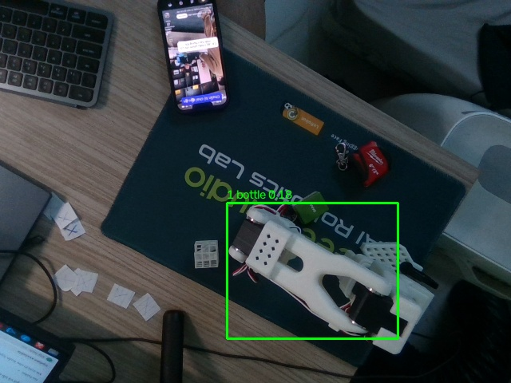
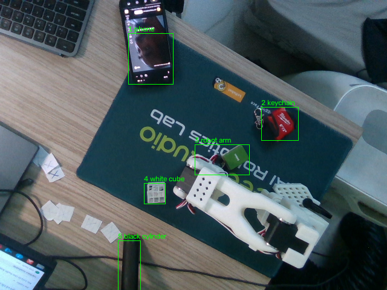
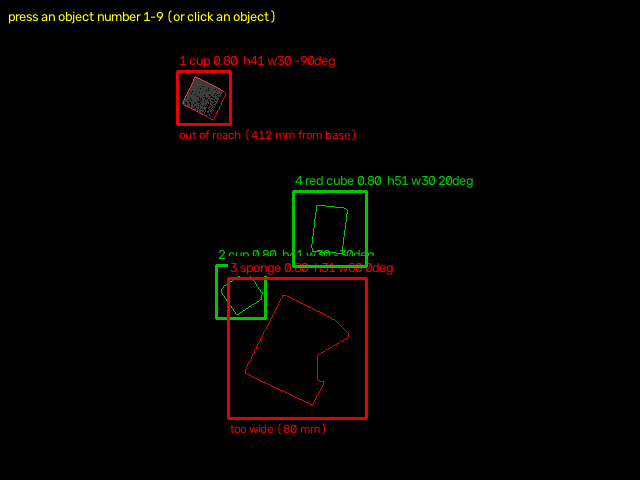

# Nhật ký làm việc 21/11/2026: gắp vật bằng camera với tay SO101 (`camera_pick.py`)

**Thư mục làm việc:** `~/robot/SO101`. Tài liệu này tổng hợp những gì đã làm trong ngày: phần cứng, phần mềm, AI, cách nhận diện và đo vật, cách lập kế hoạch chuyển động, các lỗi gặp phải và cách sửa, cách dùng, giới hạn và hướng phát triển tiếp.

---

## 1. Tóm tắt

**Mục tiêu:** chỉ cần nhìn vào ảnh camera, chọn một vật trên bàn rồi chọn chỗ đặt, tay robot SO101 tự gắp vật và đặt sang chỗ đó.

**Kết quả cuối ngày:**

- `camera_pick.py` gắp và đặt vật bằng camera. Có hai cách chọn vật:
  - **click vào vật** trên ảnh; hoặc
  - **nhận diện nhiều vật theo tên** (`--detect "green cube, tape measure"`), rồi nhấn phím số 1–9.
- Vật được **đo tự động** từ ảnh độ sâu: tâm, chiều cao, bề rộng theo chiều kẹp, chiều dài, góc xoay. Không cần thước.
- Mỗi lần gắp đều được **chạy thử trong mô phỏng vật lý MuJoCo** trước. Mô phỏng không đạt thì tay thật không chạy.
- Lập kế hoạch nhanh (0,1–0,6 giây) và **chạy nền ngay khi click chỗ đặt**, nên nhấn SPACE là tay chạy luôn.
- Các script phụ trợ được viết trong ngày:
  - `goto.py`: đưa tay gắp tới một điểm 3D bất kỳ;
  - `detector.py`: nhận diện nhiều vật;
  - `record_home.py`: ghi tư thế home bằng cách cầm tay đưa tới.

---

## 2. Phần cứng

| Thành phần | Chi tiết |
|---|---|
| Tay robot | **SO-101 follower** (TheRobotStudio / Hugging Face LeRobot), 6 servo **Feetech STS3215**: `shoulder_pan`, `shoulder_lift`, `elbow_flex`, `wrist_flex`, `wrist_roll`, `gripper` |
| Kết nối tay | USB serial `/dev/ttyACM0`, id hiệu chuẩn `my_follower`. Mỗi servo tự giữ vị trí bằng bộ PID có sẵn bên trong |
| Camera | **Intel RealSense D415**: camera màu RGB + camera độ sâu dạng **stereo hồng ngoại có máy chiếu mẫu (active IR)** |
| Cổng camera | Đang cắm **USB 2.1** nên chỉ chạy được **màu + độ sâu 640×480 @ 30 fps**. Cắm USB 3 thì lên được 1280×720 |
| Vị trí camera | Cố định phía trên bàn, cách mặt bàn khoảng **66 cm**, nhìn xuống vùng làm việc |
| Máy tính | AMD **Ryzen 5 5600H**, 16 GB RAM, **không có GPU NVIDIA**. Mọi mô hình AI chạy bằng **CPU** |

---

## 3. Phần mềm và công nghệ

| Lớp | Công nghệ | Dùng để |
|---|---|---|
| Điều khiển servo | **LeRobot** (`SO101Follower`) | Gửi góc khớp (độ) xuống servo, đọc góc hiện tại, bật/tắt torque |
| Mô hình robot | **MuJoCo** (Google DeepMind) + **MuJoCo Menagerie** (`robotstudio_so101`) | Động học thuận, Jacobian, mô phỏng vật lý, mô hình 3D để che tay robot khỏi ảnh |
| Động học ngược | **Tự viết** (Damped Least Squares) | Tính góc khớp để đầu kẹp tới một điểm với góc chúi cho trước |
| Camera | **pyrealsense2** (Intel) | Lấy ảnh màu và ảnh độ sâu, căn ảnh độ sâu theo ảnh màu, thông số nội camera |
| Xử lý ảnh | **OpenCV** | Lọc hình thái, tách vùng liên thông, hình chữ nhật bao nhỏ nhất, vẽ giao diện |
| Tính toán | **NumPy**, **SciPy** (`least_squares` khi hiệu chuẩn) | Đám mây điểm 3D, ma trận biến đổi, tối ưu hoá |
| AI nhận diện | **OpenAI CLIP ViT-B/32** (PyTorch, CPU) | Gọi tên vật bằng chữ tự do (zero-shot) |
| AI nhận diện (phụ) | **Ultralytics YOLO-World** `yolov8s-worldv2` | Phát hiện vật theo tên (open-vocabulary); giữ lại làm tuỳ chọn `--backend yolo` |
| Môi trường | conda env `lerobot`, Python 3.12 | `~/miniforge3/envs/lerobot/bin/python` |

**Không cần mạng:** trọng số CLIP (`~/.cache/clip/ViT-B-32.pt`) và YOLO-World (`models/yolov8s-worldv2.pt`) đã có sẵn trên máy. Các package `clip`, `ftfy`, `regex`, `wcwidth` được chép từ venv của `~/Camera-Detection` vào env `lerobot`.

---

## 4. Hệ toạ độ và hiệu chuẩn (nền tảng cho mọi phép đo)

### 4.1 Các hệ toạ độ

- **Hệ đế robot** (đơn vị mm trong giao diện): **x hướng ra phía trước, y sang trái, z hướng lên** tính từ mặt bàn. Gốc toạ độ của mô hình nằm **lùi sau trục xoay của đế 39 mm**.
- **Hệ camera:** điểm 3D đo được từ ảnh độ sâu.
- **Ma trận `T_base_cam`** (4×4) đổi một điểm từ hệ camera sang hệ đế: `p_đế = R · p_cam + t + hiệu chỉnh XY`.

### 4.2 Từ một pixel ra một điểm 3D

Với pixel (u, v) có độ sâu z (mét) và thông số nội của camera (fx, fy, ppx, ppy):

```
X = (u - ppx) / fx * z
Y = (v - ppy) / fy * z
p_cam = (X, Y, z)            ->   p_đế = T_base_cam * p_cam
```

`camera_pick.py` làm phép tính này **cho toàn bộ ảnh cùng một lúc** (hàm `cloud_base`), tạo ra một "đám mây điểm" 640×480 điểm trong hệ đế robot.

### 4.3 Hiệu chuẩn bàn (`table_calib.py`)

- Chạm đầu hàm kẹp cố định vào các dấu X trên bàn, rồi click lại đúng các dấu X đó trên ảnh độ sâu.
- Bộ giải tìm cùng lúc **`T_base_cam`**, **độ lệch nhỏ của 3 khớp** (`joint_offsets.json`), **độ cao mặt bàn** và **hệ số tỉ lệ độ sâu**.
- Kết quả hiện tại:
  - 7 điểm, sai số trung bình **5,3 mm**, hệ số tỉ lệ độ sâu 1,003;
  - độ lệch khớp: shoulder_lift −0,2°, elbow_flex 6,58°, wrist_flex 4,83°.
- `verify_click.py` dùng để kiểm tra: click một điểm, tay đi tới ngay phía trên điểm đó.

---

## 5. Quy trình của `camera_pick.py`

```
 Camera D415 (màu + độ sâu, 30 fps)
        |
        v
 Đám mây điểm 3D trong hệ đế robot (cloud_base)
        |
        +--> [che tay robot] mô hình 3D của tay, đặt theo góc khớp đang đọc, chiếu lên ảnh
        |
        v
 TÌM VẬT:   click vào vật  |  hoặc --detect: tìm tất cả vật + CLIP gọi tên
        |
        v
 ĐO VẬT:    tâm (x, y), chiều cao, bề rộng, chiều dài, góc xoay (describe)
        |
        v
 Chọn vật (click / phím 1-9)  ->  click CHỖ ĐẶT
        |
        v  (chạy nền ngay khi click chỗ đặt)
 LẬP KẾ HOẠCH: IK + đường đi (build_plan)  ->  KIỂM TRA MÔ PHỎNG VẬT LÝ (physics_check)
        |                                            | không đạt: thử kẹp cao hơn (20 -> 10 -> 0 mm),
        |                                            | vẫn không đạt: báo lý do, không chạy
        v
 SPACE  ->  chạy trên tay thật (30 lệnh/giây, luồng riêng; phím s = dừng)  ->  về HOME
```

---

## 6. Nhận diện vật (phần AI)

### 6.1 Thử YOLO-World trước

**YOLO-World** là mô hình phát hiện vật "từ vựng mở": gõ tên vật bằng chữ, nó vẽ khung quanh những vật khớp tên. Bên trong, nó dùng bộ mã hoá chữ của CLIP để hiểu tên.

Kết quả trên ảnh thật từ camera là **kém**:
- Không thấy khối xanh lá và khối trắng.
- Nhận nhầm tay robot thành "bottle".
- Gọi hầu hết mọi thứ là "marker pen".

Lý do:
1. Mô hình bản nhỏ (`s`).
2. Ảnh chỉ 640×480 (giới hạn của USB 2).
3. Vật nhỏ, nhìn thẳng từ trên xuống, góc nhìn hiếm gặp trong dữ liệu huấn luyện.



### 6.2 Cách đang dùng: độ sâu + CLIP (backend mặc định `depth`)

Thay vì bắt một mô hình vừa **tìm** vừa **gọi tên** vật, ta chia ra hai việc. Mỗi việc giao cho công cụ làm tốt nhất việc đó.

**Bước 1. Tìm vật bằng ảnh độ sâu (hình học, không cần AI):**
1. Tính **độ cao mặt bàn**: trung vị z của các điểm trong vành tầm với 10–42 cm.
2. Đánh dấu điểm thuộc vật khi nó **cao hơn mặt bàn 8 mm tới 15 cm**.
3. **Loại tay robot:** đọc góc khớp hiện tại, đặt mô hình 3D MuJoCo của tay theo góc đó, chiếu từng khối lưới (mesh) lên ảnh camera bằng `T_base_cam`, lấy bao lồi của từng khối, nới rộng thêm 12 px. Vùng này không bao giờ được tính là vật.
4. Lọc nhiễu bằng phép **mở hình thái** (morphological opening), rồi tách các **vùng liên thông**. Mỗi vùng có từ 120 pixel trở lên là một vật.

**Bước 2. Gọi tên bằng CLIP (AI):**
- **CLIP** (Contrastive Language–Image Pre-training, OpenAI) đưa **ảnh** và **câu chữ** về cùng một không gian vector. Ảnh và câu càng giống nhau thì hai vector càng gần nhau (độ tương đồng cosin).
- Với mỗi vật, cắt một **ô vuông rộng gấp 1,6 lần khung vật** (để có thêm ngữ cảnh) từ ảnh màu, rồi tính vector của ảnh.
- Mỗi tên được mã hoá bằng 3 mẫu câu rồi lấy trung bình (prompt ensemble): "a photo of a …", "a top-down photo of a … on a table", "a close-up photo of a …".
- Danh sách tên gồm tên bạn gõ cộng thêm hai **lớp nhiễu**: "robot arm" và "empty table". Vật nào giống lớp nhiễu nhất thì bị bỏ.
- Dùng **softmax** để ra xác suất. Dưới 0,35 thì tên hiện thành "? tên", nghĩa là không chắc.
- Mỗi lần nhận diện cả bàn mất khoảng **0,3 giây trên CPU**.

**Kết quả trên ảnh thật:**
- Gọi đúng điện thoại (0,98), ống đen (0,68) và móc khoá (0,90). Thước dây dính với móc khoá nên chung một khung.
- Khối trắng có lần bị gọi nhầm là "usb stick".
- Tìm vật luôn chính xác vì dựa vào độ sâu. Còn việc gọi tên phụ thuộc vào danh sách tên bạn gõ.



### 6.3 Giao diện nhận diện nhiều vật

- Mỗi vật có **số thứ tự** (xếp từ trái sang phải), tên, độ tin cậy, chiều cao, bề rộng và góc xoay.
- **Khung xanh** là gắp được. **Khung đỏ** là không gắp được, kèm lý do: quá rộng (trên 65 mm), quá thấp (dưới 12 mm), hoặc ngoài tầm với (ngoài 120–340 mm).
- Nhận diện **tạm dừng** khi tay đang chạy hoặc đang lập kế hoạch, để dành CPU và giữ nhịp lệnh 30 Hz.



---

## 7. Đo vật (hàm `measure` và `describe`)

| Đại lượng | Cách đo |
|---|---|
| Độ cao mặt bàn | Trung vị z của các điểm thấp (dưới 8 mm) quanh vật. Đo **tại chỗ** nên không bị ảnh hưởng nếu bàn hơi nghiêng |
| Chiều cao | **Phân vị 95%** của z các điểm thuộc vật trừ độ cao bàn. Không dùng giá trị lớn nhất vì dễ dính nhiễu |
| Mặt trên | Chỉ lấy các điểm cao hơn 60% chiều cao. Camera nhìn chéo nên các mặt bên bị che một nửa, mặt trên cho đường viền chính xác nhất |
| Tâm, bề rộng, chiều dài | `cv2.minAreaRect` (hình chữ nhật bao nhỏ nhất, được phép xoay) trên toạ độ x, y của mặt trên |
| Góc xoay (yaw) | Hướng **cạnh ngắn**, vì hai hàm kẹp khép lại dọc theo cạnh ngắn. Đưa về khoảng −90…90°, vì tay kẹp xoay 180° vẫn kẹp như nhau |

**Độ chính xác khi thử trên cảnh mô phỏng** (có nhiễu độ sâu 1,5 mm):
- tâm, bề rộng, chiều dài, góc xoay: đúng;
- chiều cao: cao hơn thực tế khoảng 2 mm.

Trên tay thật, sai số cuối cùng chủ yếu đến từ hiệu chuẩn camera (khoảng 5 mm).

---

## 8. Lập kế hoạch chuyển động (`pick_place.build_plan`)

### 8.1 Động học ngược (IK)

- Thuật toán **Damped Least Squares** (Levenberg–Marquardt), tự viết trong `keyboard_control.ik`:
  - mỗi vòng lặp: `dq = Jᵀ (J Jᵀ + λ² I)⁻¹ e`, với λ = 0,01;
  - `J` là Jacobian của điểm `gripperframe` (lấy từ `mj_jacSite` của MuJoCo).
- Giải cho 4 khớp (pan, lift, elbow, wrist flex). Có thêm một hàng ràng buộc để **khoá góc chúi** của tay kẹp, mặc định **80°** (gần thẳng đứng; ở đúng 90° IK mất ổn định).
- Kết quả luôn bị kẹp trong **giới hạn khớp đã hiệu chuẩn**, chừa 3°.
- `wrist_roll` được đặt riêng theo góc xoay của vật.

### 8.2 Các bước của một lần gắp và đặt

1. Di chuyển tới phía trên vật.
2. Hạ thẳng xuống.
3. Đóng kẹp (1,2 s; lệnh "đóng hết" để kẹp chặt, servo tự giới hạn lực).
4. Nhấc lên 8 cm.
5. Mang sang chỗ đặt.
6. Xoay cổ tay cho thẳng hàng.
7. Hạ xuống.
8. Mở kẹp.
9. Nhấc lên.
10. Về home.

Mọi đoạn đều dùng đường cong **min-jerk bậc 5** để chuyển động êm.

### 8.3 Chọn tư thế kẹp

- **Hai cách đặt khuỷu tay:** với cùng một điểm và cùng góc chúi có hai nghiệm, khuỷu cao và khuỷu thấp. Nghiệm khuỷu thấp thường làm cổ tay chạm giới hạn 95° khi nhấc lên, khiến khớp phải **nhảy 15° trong một khung hình**. Planner thử 4 tư thế ban đầu, tính trước đường nhấc lên của từng nghiệm rồi giữ nghiệm trơn tru nhất.
- **Hai cách xoay cổ tay** (lệch nhau 180°): hàm cố định và hàm di động đổi bên cho nhau, làm điểm kẹp lệch vài mm. Có vị trí chỉ một trong hai cách với tới được, nên planner thử cả hai.
- **Hàm cố định cách mép vật 8 mm:** khi đóng, hàm di động đẩy vật vào hàm cố định, nên vật nằm giữa hai đầu ngón.
- **Kẹp thấp** (`--lower 20`, mặc định của camera_pick): tâm kẹp xuống thấp hơn nửa chiều cao vật 20 mm. Đầu ngón luôn được giữ **cách bàn ít nhất 4 mm**. Ngón nằm thấp hơn tâm kẹp khoảng 7 mm.
- **Khi đặt:** tay hạ đúng độ cao lúc kẹp, cộng thêm 10 mm, nên vật không bị ép xuống bàn.

### 8.4 Đường nhấc, hạ và mang vật

- **Nhấc và hạ thẳng đứng.** Đường hạ là đường nhấc chạy ngược, nên chắc chắn kết thúc đúng tư thế kẹp.
- **Góc chúi được phép đổi từ từ** (tối đa 3° mỗi bước, hàm `ik_soft`) khi cổ tay chạm giới hạn, để khớp không bị nhảy.
- **Sát đế, tay không nâng thẳng 8 cm được:** nâng thẳng 30% đầu (vật đã rời bàn), rồi **vừa nâng vừa lùi ra xa đế** 5–9 cm. Với vật ở xa thì lùi vào trong.
- **Mang vật:** đi đường thẳng. Nếu đường thẳng đi quá sát đế thì **xoay vòng** trong không gian khớp.

### 8.5 Tốc độ

- `--speed 1.0` (mặc định): một lần gắp và đặt mất khoảng **16 giây**. Tối đa là **2.0**, khoảng 8 giây.
- Kế hoạch được lấy mẫu lại theo tốc độ đã chọn. Kiểm tra mô phỏng chạy ở **đúng tốc độ đó**.
- Giới hạn tốc độ servo tăng theo: `3° × speed` mỗi lệnh, tối đa 6°.

---

## 9. Kiểm tra trong mô phỏng vật lý (`physics_check`)

- Dựng trong MuJoCo một **hộp đúng kích thước và góc xoay đo được**, đặt ở vị trí vật, rồi chạy toàn bộ kế hoạch với vật lý thật (va chạm, ma sát, lực kẹp).
- **Đạt** khi đủ cả ba điều kiện:
  - vật được nâng lên hơn 40 mm;
  - vật rơi cách chỗ đặt dưới 20 mm;
  - vật đứng thẳng.
- Không đạt thì **thử kẹp cao hơn** (20 → 10 → 0 mm). Vẫn không đạt thì báo lý do và **không chạy tay thật**.
- Trong mô phỏng, tay không nắm được vật (nâng dưới 20 mm) thì báo là **do vị trí vật**, không phải do chỗ đặt.

---

## 10. Chạy trên tay thật

- Kế hoạch được gửi từ một **luồng riêng**: 30 lệnh/giây, giữ đúng nhịp bằng `perf_counter`.
- `RealArm.send_sim`:
  - đổi góc mô phỏng sang góc servo (cộng độ lệch khớp);
  - kẹp trong giới hạn khớp;
  - giới hạn tốc độ mỗi lệnh.
- Nhấn **`s`** để dừng ngay; tay giữ nguyên tư thế.
- Kết thúc bằng việc về **home**. Home ghi bằng `record_home.py`, lưu theo độ servo thật trong `home_pose.json`.

---

## 11. Hiệu năng: tối ưu thời gian lập kế hoạch

| Thay đổi | Trước | Sau |
|---|---|---|
| IK: tính thành phần z của tích có hướng trực tiếp, thay vì gọi `np.cross` 44 nghìn lần; cấp phát mảng một lần | 0,3–2,9 s | **0,07–0,63 s** (kế hoạch **giống hệt**, sai khác dưới 10⁻⁶) |
| Đọc mô hình mô phỏng một lần rồi dùng lại | ~0,4 s mỗi lần kiểm tra | ~0,05 s |
| Lập kế hoạch **chạy nền ngay khi click chỗ đặt** | đợi sau khi nhấn SPACE | thường xong trước khi nhấn SPACE |
| Tạm dừng nhận diện trong lúc lập kế hoạch | CLIP giành CPU | CPU dành hết cho planning |

Vật ở chỗ khó (sát đế, bên cạnh) vẫn có thể mất 1–4 giây, vì planner phải thử nhiều tư thế và nhiều mức kẹp.

---

## 12. Diễn biến trong ngày

| # | Việc | Ghi chú |
|---|---|---|
| 1 | Đổi tên hướng dẫn camera thành `SETUP_TABLE_2D_CALIB.md` | Sửa mọi chỗ nhắc tới tên cũ |
| 2 | Viết `camera_pick.py` và `goto.py`; thêm phím `+`/`-` vào `verify_click.py` | Đo vật bằng độ sâu, kiểm tra mô phỏng trước khi chạy |
| 3 | Tuỳ chọn `--lower` (kẹp thấp hơn 20 mm) | Chặn an toàn để ngón cách bàn ít nhất 4 mm |
| 4 | Sửa lỗi "Cannot move straight up" khi vật gần đế | Đổi góc chúi từ từ; tự thử lại với mức kẹp cao hơn; giữ vật đã chọn khi thất bại |
| 5 | Tăng tốc: mặc định 1.0, tối đa 2.0 | Tìm và sửa lỗi **khớp nhảy 15°** do chọn sai nghiệm khuỷu tay |
| 6 | Vật ở (−9, −153) không gắp được | Thử cả hai cách xoay cổ tay; mang vật theo đường vòng khi đường thẳng quá sát đế |
| 7 | Nhận diện nhiều vật: thử YOLO-World, chuyển sang **độ sâu + CLIP** | Che tay robot bằng mô hình 3D; sửa lỗi crash khi thoát (luồng PyTorch) |
| 8 | Tối ưu thời gian lập kế hoạch | IK nhanh khoảng 4 lần, lập kế hoạch chạy nền |
| 9 | Robot đặt vật cách đế 84 mm rồi không gắp lại được | Đường nhấc "lùi ra xa đế"; thông báo rõ hơn; cảnh báo khi đặt sát đế |
| 10 | `record_home.py` | Ghi home bằng cách cầm tay đưa tới; mọi script dùng chung |

---

## 13. Cách dùng nhanh

```bash
cd ~/robot/SO101
systemctl --user stop d415-lab.service            # giải phóng camera nếu dịch vụ cũ đang giữ

python camera_pick.py                             # click vật -> click chỗ đặt -> SPACE
python camera_pick.py --detect "green cube, white cube, tape measure, black cylinder"
python camera_pick.py --dry                       # tay giả: chỉ camera, đo vật, mô phỏng
python camera_pick.py --speed 1.5 --lower 20      # nhanh hơn, kẹp thấp 20 mm

python goto.py 250 0 80                           # đưa tâm kẹp tới điểm 3D (mm)
python record_home.py                             # ghi tư thế home
python detector.py "green cube, tape measure"     # thử nhận diện trên 1 ảnh -> debug/detect.jpg
```

**Phím trong cửa sổ `camera_pick`:**

| Phím | Tác dụng |
|---|---|
| click | Chọn vật (lần đầu), chọn chỗ đặt (lần sau) |
| 1–9 | Chọn vật theo số (khi dùng `--detect`) |
| SPACE | Chạy (nếu đang lập kế hoạch thì tự chạy khi xong) |
| s | Dừng tay ngay |
| r | Chọn lại từ đầu |
| h | Về home |
| q | Thoát |

---

## 14. Các tham số quan trọng

| Tham số | Giá trị | File | Ý nghĩa |
|---|---|---|---|
| `OBJ_MIN` | 8 mm | camera_pick, detector | Cao hơn mặt bàn bao nhiêu thì tính là vật |
| `TOP_FRACTION` | 0,6 | camera_pick | Phần trên cùng dùng để đo đường viền |
| `MAX_WIDTH` / `MIN_HEIGHT` | 65 mm / 12 mm | camera_pick | Vật gắp được |
| `REACH` | 10–42 cm | detector | Vùng tìm vật |
| `UNSURE` | 0,35 | detector | Ngưỡng tin cậy của CLIP |
| `PITCH` | 80° | pick_place | Góc chúi của tay kẹp |
| `LIFT` | 80 mm | pick_place | Độ cao nhấc lên |
| `CLEAR` | 8 mm | pick_place | Khoảng hở của hàm cố định với mép vật |
| `MIN_TIP` | 4 mm | pick_place | Khoảng cách tối thiểu từ đầu ngón tới bàn |
| `LIFT_DRIFT` | 0 / +5 / +9 / −5 cm | pick_place | Độ lệch ngang khi không nâng thẳng được |
| `--lower` | 20 mm | camera_pick | Kẹp thấp hơn nửa chiều cao vật |
| `--speed` | 1,0 (tối đa 2,0) | camera_pick, pick_place, goto | Tốc độ |

---

## 15. Giới hạn hiện tại

1. **Vật mỏng dưới khoảng 1 cm** (USB, giấy) không có trong ảnh độ sâu, nên không tìm thấy.
2. **Hai vật chạm nhau** thành một vật. Nên để cách nhau trên 1–2 cm.
3. **Vật bóng loáng hoặc trong suốt:** D415 không đo được độ sâu.
4. CLIP **chỉ chọn trong danh sách tên** bạn gõ. Thiếu tên thì vật lạ bị gán nhầm.
5. Chỉ kẹp **từ trên xuống**. Vật cao hơn khoảng 60 mm hoặc rộng hơn 65 mm không gắp được.
6. Vùng làm việc tốt nhất là **130–300 mm từ trục đế**. Sát đế hoặc ở xa thì có thể không gắp được.
7. Sai số tổng khoảng **5 mm**, chủ yếu do hiệu chuẩn camera và USB 2 (độ phân giải thấp).
8. Mô phỏng lý tưởng hơn thực tế (servo thật yếu hơn, ma sát khác), nên tốc độ 2.0 cần thử cẩn thận.

---

## 16. Hướng phát triển tiếp

1. **Biết khi gắp trượt:** sau khi đóng kẹp, nếu tay kẹp đóng hết là không có vật, thì thử lại. Có thể dùng camera kiểm tra vật đã rời chỗ chưa.
2. **Phát hiện va chạm** bằng dòng điện servo (`Present_Current`).
3. **Cắm camera vào USB 3** để có độ sâu 1280×720 và đo chính xác hơn.
4. **Hiệu chỉnh vòng kín:** khi tay đã ở trên vật, so vị trí đầu kẹp với vật trên ảnh rồi chỉnh vài mm trước khi hạ xuống.
5. **Lệnh bằng chữ** ("đặt khối xanh vào bát") và **phân loại tự động** theo tên vào từng ô.
6. **Học máy với LeRobot:** dùng `camera_pick` để tự thu dữ liệu gắp thành công, rồi huấn luyện policy **ACT** hoặc **SmolVLA** (cần GPU, có thể thuê cloud).
7. Đưa thư mục `SO101` lên **GitHub** để lưu phiên bản.

---

## 17. Các file liên quan

| File | Nội dung |
|---|---|
| `camera_pick.py` | Chương trình chính: camera → đo vật → lập kế hoạch → mô phỏng → tay thật |
| `detector.py` | Nhận diện nhiều vật: độ sâu + che tay robot + CLIP (hoặc YOLO-World) |
| `pick_place.py` | Lập kế hoạch gắp và đặt, IK nâng cao, kiểm tra mô phỏng; chạy được không cần camera |
| `keyboard_control.py` | Hàm IK dùng chung; điều khiển bằng bàn phím |
| `so101_real.py` | Lớp `RealArm`: đổi góc mô phỏng ↔ servo, giới hạn, home, bù võng |
| `goto.py` | Đưa tay gắp tới điểm 3D |
| `record_home.py` | Ghi tư thế home |
| `verify_click.py`, `table_calib.py` | Kiểm tra và hiệu chuẩn camera |
| `T_base_cam.npy`, `joint_offsets.json`, `home_pose.json` | Kết quả hiệu chuẩn và home |
| `models/yolov8s-worldv2.pt` | Trọng số YOLO-World |
| `debug/camera_pick_log.txt` | Nhật ký mọi lần chạy |
| `SETUP_TABLE_2D_CALIB.md`, `DEPLOY_REAL_SO101.md` | Hướng dẫn chi tiết |
